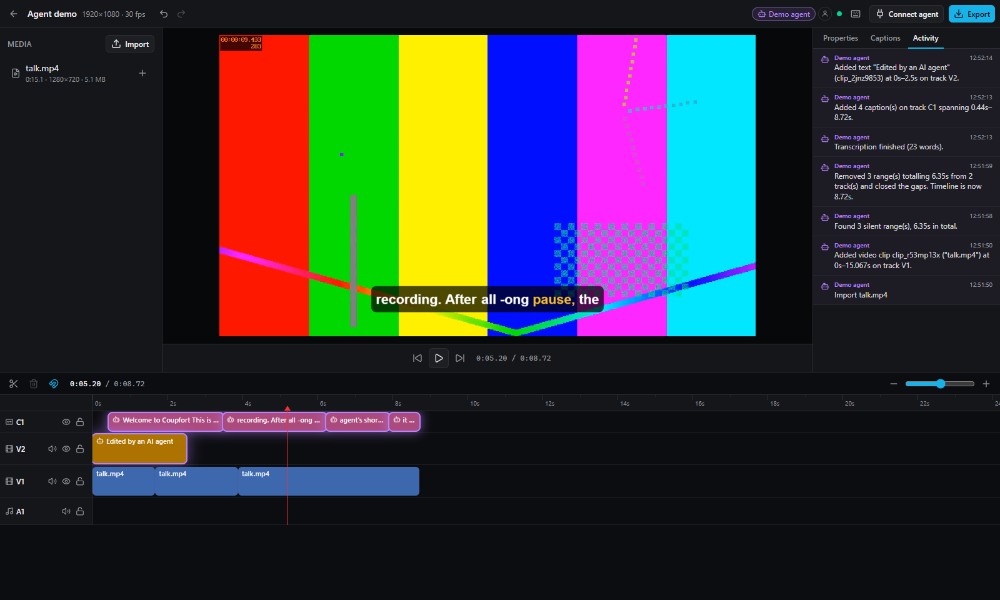
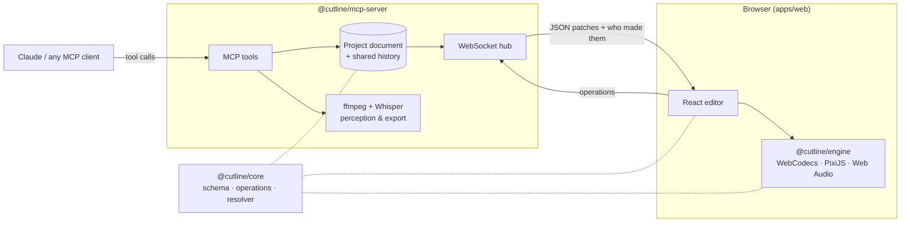

<p align="center">
  
</p>

<h1 align="center">Cutline</h1>

<p align="center">
  <b>An open-source browser video editor with a first-class MCP server.</b><br>
  Your AI agent edits the timeline through tool calls. You watch every change happen live, and can take over at any time.
</p>

<p align="center">
  <a href="https://github.com/Aepzie/cutline/actions/workflows/ci.yml"></a>
  <a href="LICENSE"></a>
  
  
</p>

> 🎬 _Demo GIF placeholder: Claude removes silences and adds captions while the timeline updates live. (Contributions welcome: record one with `pnpm --filter @cutline/mcp-server demo`.)_

---

Say _"remove the silences and add captions"_ to Claude, and watch the cuts, ripples and subtitles
appear in your browser as they happen, highlighted so you can see what the agent touched. Then
undo what you don't like, tweak the rest by hand, and export an MP4.

The timeline is a **declarative JSON document**. The browser editor and the MCP server change it
through the **same typed operations**, so there are no GUI-only features: anything you can do with
the mouse, an agent can do with a tool call (and vice versa).

## Features

**Editor (browser)**

- Multi-track timeline: drag, trim, split, ripple delete, zoom, snapping, keyboard shortcuts
- WebGL preview (PixiJS) with real-time playback, decoding via WebCodecs (Mediabunny)
- Canvas editing: click to select, drag, scale and snap overlays directly in the preview
  (arrow keys nudge; every drag is one undo step)
- Text overlays, shapes (rectangles, rounded boxes, ellipses), captions with word highlighting,
  transforms, keyframes, fades, crossfades,
  dip-to-black, brightness/contrast/saturation/blur
- Captions editor, properties panel, asset bin with drag-and-drop upload
- **Live agent view**: agent edits pulse on the timeline, an activity feed shows what happened
  (also to editors that join later), presence shows which agent is connected
- Shared undo/redo: undo the agent's change, or let the agent undo yours
- Export in the browser (WebCodecs in a Web Worker, MP4 H.264/AAC) or on the server (ffmpeg)

**MCP server (25 tools)**

- **Editing:** `create_project`, `get_project`, `add_asset`, `add_clip`, `split_clip`, `trim_clip`,
  `move_clip`, `delete_clip`, `delete_range`, `set_clip_property`, `add_text_overlay`, `add_shape`,
  `add_captions`, `add_transition`, `set_audio_volume`, `apply_operations`, `undo`, `redo`
- **Perception** (so the agent isn't editing blind): `get_transcript` (word timestamps, local
  Whisper), `get_frames` (composited thumbnails), `detect_silence`, `detect_scenes`,
  `get_waveform_summary`
- **Output:** `render_preview`, `export_video`
- Streamable HTTP and stdio transports; strict Zod input schemas; every result has a one-line
  summary plus structured data; errors say what to do next.

See the [MCP tool reference](docs/mcp-tools.md) (generated from the schemas).

## Quick start

Requirements: **Node.js ≥ 22**, **pnpm 10** (`npm i -g pnpm`), and **ffmpeg** on your `PATH`
(for the perception tools and server-side export; editing and browser export work without it).

```bash
git clone https://github.com/Aepzie/cutline.git
cd cutline
pnpm install
pnpm dev
```

Open **http://localhost:5173** for the editor. The MCP endpoint is **http://localhost:4100/mcp**.

## Connect Claude

**Claude Code** (HTTP transport, talks to the running dev server):

```bash
claude mcp add --transport http cutline http://localhost:4100/mcp
```

**Claude Desktop**: run `pnpm build` once, then add to `claude_desktop_config.json`
(Settings → Developer → Edit Config):

```json
{
  "mcpServers": {
    "cutline": {
      "command": "node",
      "args": [
        "/ABSOLUTE/PATH/TO/cutline/packages/mcp-server/dist/cli.js",
        "--stdio",
        "--serve-web"
      ]
    }
  }
}
```

The stdio process bridges to the running Cutline server if there is one (so your open editor sees
the edits), or starts one itself. Then ask something like:

> Import ~/Videos/talk.mp4 into Cutline, remove the silences, add captions and export an MP4.

More options (tokens, Docker, other clients) are in
[docs/connect-claude.md](docs/connect-claude.md). No agent at hand? Run the scripted demo agent:
`pnpm --filter @cutline/mcp-server demo -- /absolute/path/to/video-with-speech.mp4`.

## How it works



- `@cutline/core` holds the Zod schema, 18 pure edit operations, JSON Patch generation, undo/redo,
  migrations and the **resolver** that turns the document into "what is visible and audible at
  time t". It has no DOM and no Node dependencies, and 100 % test coverage.
- The **server** owns the documents and applies operations one at a time, so a human and an agent
  can edit simultaneously without conflicts. It broadcasts each change as JSON Patch along with its
  origin.
- The **engine** renders the resolver's output with WebGL; the **server renderer** turns the same
  output into an ffmpeg filtergraph, so `get_frames` shows the agent what you see.

Details: [docs/ARCHITECTURE.md](docs/ARCHITECTURE.md).

## Self-hosting with Docker

```bash
docker compose up --build
```

Editor and MCP endpoint are then on http://localhost:4100 (`/mcp`). Put media into `./media`; it is
available to agents as `/media/...`. Set `CUTLINE_TOKEN` before exposing the server beyond
localhost (see [SECURITY.md](SECURITY.md)).

## Project layout

| Path                  | What                                                                      |
| --------------------- | ------------------------------------------------------------------------- |
| `packages/core`       | Schema, operations, patches, history, resolver, analysis helpers          |
| `packages/engine`     | Browser preview player and exporter (WebCodecs, Mediabunny, PixiJS)       |
| `packages/mcp-server` | MCP server, HTTP API, WebSocket sync, storage, ffmpeg/Whisper integration |
| `apps/web`            | React + Vite + Tailwind + shadcn/ui editor                                |
| `docs`                | Architecture, tool reference, guides                                      |
| `fixtures`            | Generator for synthetic, CC0 test media (`pnpm fixtures`)                 |

## Development

```bash
pnpm fixtures     # generate test media (needs ffmpeg)
pnpm test         # unit + integration tests
pnpm e2e          # Playwright smoke test
pnpm lint && pnpm typecheck
pnpm docs:tools   # regenerate docs/mcp-tools.md
```

See [CONTRIBUTING.md](CONTRIBUTING.md). Commits follow Conventional Commits; releases use
Changesets.

## Roadmap

- [ ] Speed changes / time remapping, audio-only waveforms on the timeline
- [ ] Browser-side rendering for `export_video` when an editor is connected
- [ ] More transitions (wipes, slides) and effects (LUTs, chroma key)
- [ ] S3/R2 storage adapter (the interface exists, see [docs/storage.md](docs/storage.md))
- [ ] Multi-user collaboration with per-user undo
- [ ] Proxy media generation for large/odd source formats on the server
- [ ] Prompts/resources in MCP (e.g. "edit recipes"), OAuth for remote deployments

## FAQ

**Does it work without an AI agent?** Yes. It's a normal (if young) browser video editor.

**Which models/clients work?** Any MCP client. It is developed against Claude Desktop and Claude
Code; the tools are plain JSON-schema'd tools without client-specific features.

**Where does transcription run?** Locally, with Whisper via transformers.js (ONNX Runtime). The
model (~80 MB) is downloaded from the Hugging Face Hub on first use. Nothing is sent to a cloud API.

**Why ffmpeg if the browser can encode video?** Agents often run without an editor tab open.
ffmpeg makes perception (silence, scenes, frames) and export work headlessly. It is used as an
external program and is not bundled, which keeps this repository MIT-clean.

**Can the agent and I edit at the same time?** Yes. Operations are applied in order by the server
and address clips by id, not position. Undo is shared and labelled with who made each change.

## Limitations

Cutline is a v0.1. Things to know:

- **Browser support:** the editor needs WebCodecs + WebGL (Chrome/Edge 94+; Safari and Firefox
  support is partial). Formats the browser can't decode can be converted with ffmpeg.wasm on upload
  (opt-in; downloads ~30 MB).
- **Two renderers:** the server renderer approximates a few preview features. Caption word
  highlighting, text rotation and effects on text are preview/browser-export only (tools report
  these as warnings).
- **History is in memory:** undo/redo resets when the server restarts; documents themselves are
  persisted to disk.
- **No speed changes, nested sequences, color grading or multi-user permissions yet.**
- **Transcription quality** depends on the Whisper model (`CUTLINE_WHISPER_MODEL`); the default
  `whisper-base` is fast but not perfect, especially for names.
- **Security:** designed for local use. It binds to `127.0.0.1` by default. Read
  [SECURITY.md](SECURITY.md) before exposing it.
- Large projects (hours of media, thousands of clips) are untested.

## License

[MIT](LICENSE). Third-party licenses are summarized in [docs/licenses.md](docs/licenses.md).
Notably, [Mediabunny](https://mediabunny.dev) is MPL-2.0 (used unmodified), and ffmpeg is an
external runtime dependency, not distributed with Cutline.
