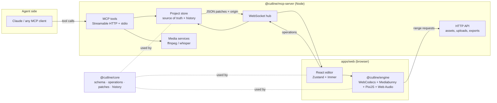
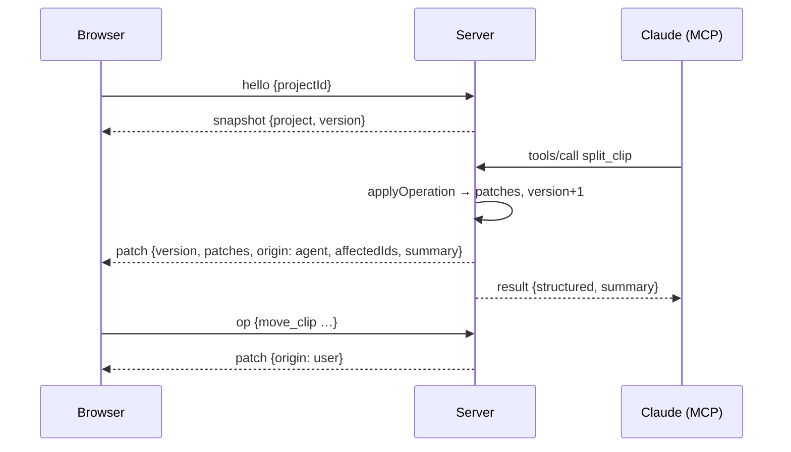

# Architecture

Cutline is a browser-based video editor whose timeline is a **declarative JSON
document**. The browser UI and AI agents (through MCP) edit that same document
through the same **typed operations**. Nothing is GUI-only.

## Packages

| Package               | Runs in   | Responsibility                                                                                                                                                                       |
| --------------------- | --------- | ------------------------------------------------------------------------------------------------------------------------------------------------------------------------------------ |
| `@cutline/core`       | anywhere  | Zod schemas, pure edit operations, JSON Patch generation/application, undo/redo history, schema migrations, the frame/audio **resolver** and pure analysis helpers. No DOM, no Node. |
| `@cutline/engine`     | browser   | Preview player and exporter: Mediabunny (demux/decode via WebCodecs, mux/encode), PixiJS (WebGL compositing), Web Audio (playback mixing), OPFS asset cache, export Web Worker.      |
| `@cutline/mcp-server` | Node ≥ 22 | Source of truth for projects. MCP server (official TS SDK, Streamable HTTP + stdio), WebSocket sync hub, HTTP API, storage adapters, perception + server-side rendering via ffmpeg.  |
| `@cutline/web`        | browser   | React + Vite + Tailwind + shadcn/ui editor. Timeline, preview, asset bin, properties, captions, export dialog, live agent activity.                                                  |

All internal packages are consumed as TypeScript source ("just-in-time"
packages): Vite compiles them for the web app, `tsx`/`tsup` for the server.
This keeps one build step per app and avoids stale `dist/` folders.

## Key decisions

### 1. The document

- Times are **seconds** (floats, normalized to microsecond precision). LLMs
  reason in seconds; integer frame counts would leak frame-rate details into
  every tool call.
- `tracks` is an ordered array (index 0 is the bottom layer). Each track holds
  clips sorted by `start`; clips on one track never overlap.
- Track kinds: `video` (video, image and text clips), `audio`, `caption`.
- Clip kinds: `video`, `audio`, `image`, `text`, `caption`.
- Visual clips have a `transform` (x, y, scale, rotation, opacity), optional
  `keyframes` per animatable property, `effects` (brightness, contrast,
  saturation, blur), `fadeIn`/`fadeOut` and an optional `transitionIn`
  (`crossfade` or `dipToBlack`, centered on the cut).
- `schemaVersion` + an ordered migration list lets old documents load.

### 2. Operations, patches, history

Every edit is an **operation**: a Zod-validated object such as
`{ type: "split_clip", clipId, time }`. `applyOperation(project, op)` is pure
and returns the next project plus forward/inverse **JSON Patches** (RFC 6902,
generated from Immer patches). The history stores inverse patches, so undo/redo
is patch application. Errors are `CutlineError`s with a code and an actionable
hint ("clip c_9 not found; existing clips: …").

The server applies operations **serially**, so there is no rebasing or CRDT.
Operations are intent-based (they address clips by id, not by array index),
which is what makes a single linear history safe for a human and an agent
editing at the same time. Undo is shared: the human can undo the agent.

### 3. Sync

The browser never mutates the document locally; drags show a transient ghost
and commit an operation on drop. On localhost the round trip is ~1 ms. If a
client sees a version gap it requests a fresh snapshot.

### 4. Rendering

The pure resolver in core (`resolveFrame(project, t)`, `resolveAudioSegments`)
turns the document into "what is visible/audible at time t". Both renderers use
it:

- **Browser engine** (preview + export): Mediabunny decodes via WebCodecs,
  PixiJS composites on WebGL, Web Audio mixes playback. Export runs in a Web
  Worker with an `OffscreenCanvas`, encodes with WebCodecs and muxes MP4 with
  Mediabunny (H.264/AAC when the browser supports it, otherwise VP9/Opus).
  Assets are cached in OPFS so seeking large files does not hit the network.
- **Server renderer** (MCP `render_preview` / `export_video`, headless): builds an
  ffmpeg filtergraph from the same resolver output. This keeps agents useful
  without an open browser tab.

ffmpeg is a **runtime prerequisite** found on `PATH` (or `FFMPEG_PATH`), never
bundled, so no GPL/LGPL binary ships in this MIT repository. ffmpeg.wasm is
only an optional browser fallback for formats WebCodecs cannot decode; its core
is loaded from a CDN on demand and is not part of the bundle.

### 5. Perception

Agents are not blind:

| Tool                   | Implementation                                                                      |
| ---------------------- | ----------------------------------------------------------------------------------- |
| `get_transcript`       | Whisper via transformers.js (ONNX, runs locally), word timestamps, cached per asset |
| `get_frames`           | ffmpeg frame extraction composed per the resolver → small JPEGs as MCP images       |
| `detect_silence`       | RMS envelope (ffmpeg PCM → pure core analysis), mapped to timeline time             |
| `detect_scenes`        | ffmpeg scene score, mapped to timeline time                                         |
| `get_waveform_summary` | Downsampled peak/RMS envelope with loud/quiet segments                              |

Analysis results are cached on disk per asset.

### 6. Storage

`ProjectStore` (JSON documents) and `BlobStore` (asset files, exports, cache)
interfaces with local-disk implementations under `CUTLINE_DATA_DIR`
(default `./.cutline-data`). An S3/R2 implementation only has to implement the
same two interfaces; see [storage.md](./storage.md).

### 7. MCP transports

- **Streamable HTTP** at `http://localhost:4100/mcp` (same process as the UI
  backend, so changes appear live).
- **stdio** (`cutline-mcp --stdio`): if a Cutline server is already running it
  bridges to it, otherwise it starts one in-process. Either way the browser
  sees the changes.

### 8. Security defaults

The server binds to `127.0.0.1`, validates `Host` headers (DNS-rebinding
protection), and only reads local files from `CUTLINE_MEDIA_ROOTS`. Setting
`CUTLINE_TOKEN` requires a bearer token on every API/MCP/WebSocket request,
which is the expected setup for any non-local deployment.

## Non-goals for v0.1

Multi-user collaboration beyond one human + agents, GPU effects beyond a
basic set, speed ramps, nested sequences, color grading, and cloud storage
adapters (the interface exists; the implementation does not).
